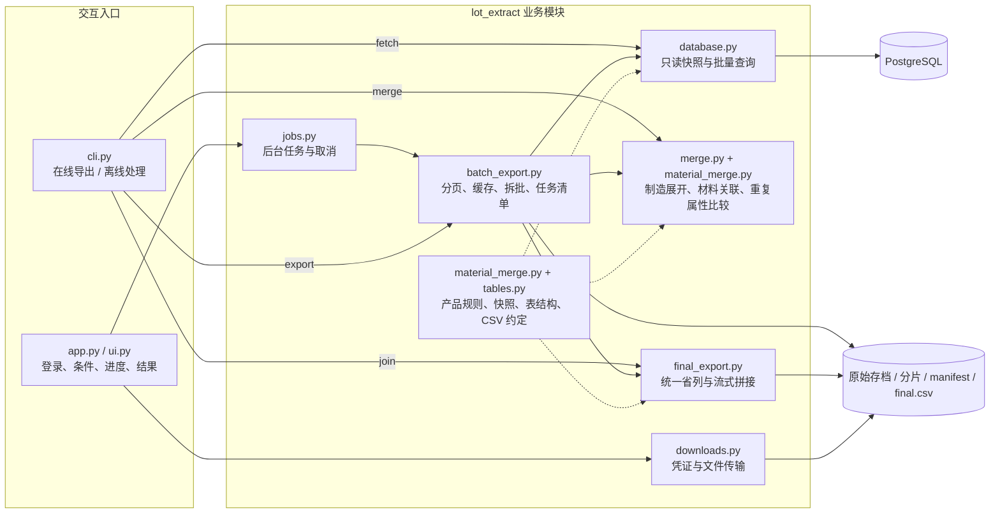
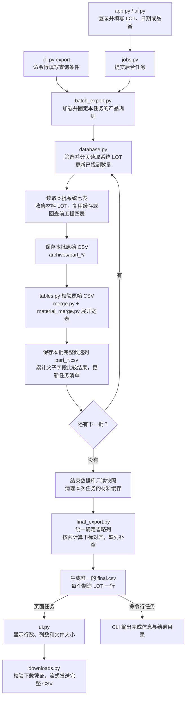
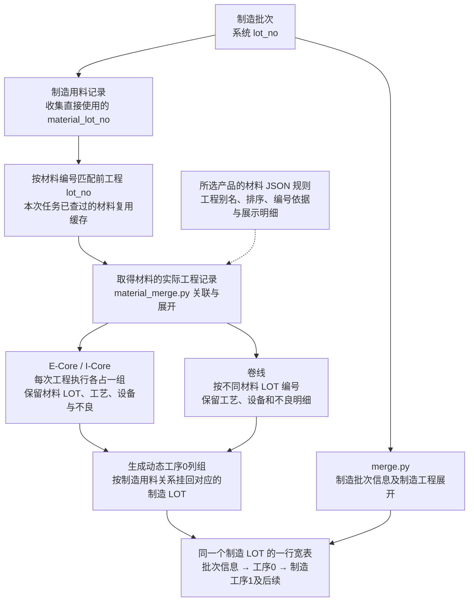

# 制造数据抽取项目

按系统 LOT、批次实际结束日期、品番查询 PostgreSQL，生成**每个制造 LOT 一行**的 CSV 宽表。填写多个条件时取交集。前工程按直接用料的 `material_lot_no` 匹配材料自身的 `lot_no`，日期和品番只筛系统 LOT。

技术栈为 Python、Streamlit、Psycopg 和标准库 CSV / SQLite。材料工程由 JSON 配置动态展开，当前 E-Core、I-Core、卷线均保留设备和不良，最终统一精简可由父字段还原的重复属性。

## 项目文件

- `app.py` 启动页面，`ui.py` 负责操作界面。
- `cli.py` 统一提供批量导出、单 LOT 取数、离线合并、最终拼接和 CSV 筛选命令。
- `lot_extract/` 存放业务代码，`tests/` 保留离线回归用例。
- [当前开发文档](docs/制造数据条件抽取系统_开发文档_V0.4.md)和[可视化导入计划表](docs/reference/可视化导入计划表.xlsx)位于 `docs/`。

业务代码按下面的顺序阅读：

| 文件 | 负责什么 |
|---|---|
| `lot_extract/database.py` | 产品配置、查询条件、数据库读取和单次原始存档 |
| `lot_extract/tables.py` | 原始表结构、LOT 规则、CSV 校验、数量格式与去重证据 |
| `lot_extract/merge.py` | 制造工程展开、材料挂接和离线合并 |
| `lot_extract/material_merge.py` | 产品规则快照、材料执行关联及工序0展开 |
| `lot_extract/batch_export.py` | 分页取数、材料缓存、批量导出流程 |
| `lot_extract/final_export.py` | 汇总去重证据，按列下标对齐并生成最终 CSV |
| `lot_extract/jobs.py` | 后台任务、进度快照和取消 |
| `lot_extract/downloads.py` | 下载凭证与文件传输 |

页面主流程是 `ui.py → jobs.py → batch_export.py`。修改制造展开看 `merge.py`，修改材料展开看 `material_merge.py`，工程别名和展示选项改 `material_rules.json`。

## 项目流程图

### 模块架构

下图展示运行职责和数据流。具体查询、展开和文件写入都在 `lot_extract/` 内，页面和命令行共用这些实现。



### 整体导出流程

下面是页面查询和 `cli.py export` 共用的批量导出流程。每批处理完整的系统 LOT，原始数据和中间结果逐批落盘。



- 页面每两秒读取后台进度快照；查询阶段显示递增数量，最终 CSV 生成阶段显示写入进度条。
- 查询没有结果时记录零行任务，不生成 CSV；取消或失败时保留已完成的中间结果。上图展示正常有数据的路径。
- 单批超过资源上限时自动拆成更小的批次重试；单个 LOT 仍超限会报错，不截断记录。

### 材料 LOT 如何展开到同一行

关联方向是 **制造用料的 `material_lot_no` → 前工程的 `lot_no`**。材料增加的是工序0列组，最终行的主键始终是制造 `lot_no`。



材料查询只使用材料 LOT，不附加制造批次的日期或品番条件，也不递归查询材料的上游。E-Core、I-Core 保留设备和不良；卷线同一材料的重复引用共用编号，额外执行保留在该材料组内。未识别工程或未匹配明细保留在异常列组，并产生核对提示。

## 启动

在项目目录安装依赖并运行：

```powershell
python -m pip install -r requirements.txt
python -m streamlit run app.py --server.address 127.0.0.1
```

页面使用 `.env` 的 `APP_PASSWORD` 登录。先在项目根目录创建本地 `.env`，填写自己的连接信息，文件不提交到 Git：

```dotenv
APP_PASSWORD=请替换为页面登录密码
LOT_PRODUCTS=DFEC
DB_HOST=请填写数据库地址
DB_PORT=5432
DB_NAME=请填写数据库名
DB_USER=请填写只读账号
DB_PASSWORD=请填写数据库密码
DB_SCHEMA=public
DB_TIMEZONE=Asia/Shanghai
DB_SSLMODE=prefer
```

DFEC 优先使用 `DFEC_DB_*`，未填写时沿用上述 `DB_*`。默认 Schema 为 `public`，日期时区为 `Asia/Shanghai`。

接入结构和关联键相同的另一个产品时，在同一份本地 `.env` 增加产品代码和带前缀的连接设置：

```dotenv
LOT_PRODUCTS=DFEC,ABC
ABC_DB_HOST=
ABC_DB_PORT=5432
ABC_DB_NAME=
ABC_DB_USER=
ABC_DB_PASSWORD=
ABC_DB_SCHEMA=public
ABC_DB_TIMEZONE=Asia/Shanghai
ABC_LOT_PREFIX=A
ABC_LOT_PREFIX_ONCE=0
```

复制 `lot_extract/material_rules.json` 为 `lot_extract/material_rules_abc.json`，按实际数据填写工程名称、别名、编号方式和明细类型。DFEC 使用默认文件，新产品须提供自己的规则文件。`ABC_LOT_PREFIX=*` 接收所有非空系统 LOT；`ABC_LOT_PREFIX_ONCE=1` 要求前缀只出现一次，DFEC 默认开启，其他产品默认关闭。前缀按大小写精确匹配，`%` 和 `_` 等字符按字面处理。

重启后，页面会显示产品数据库选择。每次查询使用选中的连接和规则。所有产品须提供相同的表结构、关联键和业务含义。规则快照写入任务及各原始存档的 `manifest.json`，供离线合并和拼接复用。

## 原始文件和合并宽表

页面查询在后台按完整系统 LOT 分批处理，保存到 `outputs/queries/<产品>/batch_<任务编号>/`。可用 `EXPORT_DIR` 指定存档根目录。完成后自动按列名对齐，拼接为一份 `final.csv`。`part_*.csv` 只作为中间分片，`archives/part_*/` 保存对应的七张系统原始表和四张 `upstream_*.csv`。任务的 `manifest.json` 记录行数、列数、各阶段耗时、缓存命中及表头指纹。空表保留表头。

`lot_extract/merge.py` 负责制造工程展开和整体合并；`material_merge.py` 按制造用料 `material_lot_no` 找到前工程的 `lot_no`，把匹配到的材料工程接到同一行。每个制造 LOT 一行。

输出按「制造批次信息 → 工序0材料工程 → 工序1及后续制造工程」排列。

材料列按所选产品的 JSON 配置顺序和别名规则生成。工程名归一化大小写、空格、连字符和下划线后与完整别名匹配。数据库出现新的正式名称时，在配置中补上别名并重启服务。E-Core 和 I-Core 每次执行各占一组，展示材料 LOT、工序键、道次、工艺字段、设备和不良。卷线按不同材料 LOT 编号，例如 `工序0_卷线1_material_lot_no` 和 `工序0_卷线2_material_lot_no`。同一制造 LOT 重复引用同一卷线材料时共用一个编号，额外的卷线执行在该材料组内保留。

材料明细按材料 LOT、工序键和道次关联执行。制造及材料不良都用代码确定列名，例如 `工序0_卷线1_不良_代码01` 保存数量，`工序0_卷线1_不良_代码01_名称` 保存原名称。独立记录落入同一列组时用 `_记录2` 等后缀区分，数量逐条保留；原始候选键重复仍会报错。宽表中的 `defect_qty`、`input_qty`、`output_qty` 去除小数尾零，原始存档保留原格式。

最终拼接汇总分片中每个候选列的父子值比较结果。只有所有实际记录都能从同一个父列还原的字段才省略。出现差异、空值差异或缺少父值时保留整列的原值，省略列及对应的最终父列记录在 `final_csv.omitted_columns`。因此中间分片的列数可能大于最终文件；详情见[开发文档的去重流程](docs/制造数据条件抽取系统_开发文档_V0.4.md#5-重复属性如何精简)。

系统 LOT 按所选产品规则筛选。DFEC 默认保留大写 `E` 开头且仅含一个大写 `E` 的 LOT。材料 LOT 仅按用料编号回查。批处理没有符合条件的 LOT 时记录零行任务。

页面每两秒刷新查询状态，显示已找到系统 LOT 数和已整理行数，数量随批次处理递增。查询阶段总数未知，使用动态状态提示，不额外执行全年 LOT 总数查询；取数结束后，按实际写入行数显示完整 CSV 的生成进度条。任务运行期间可取消。

查询完成后，页面展示数据行数（不含表头）、列数和实际 CSV 文件大小，并提供带 emoji 的完整 CSV 下载按钮。中间分片和任务清单只保存在服务器，不提供页面下载入口。完整文件通过同端口 HTTP 文件接口按块传输，支持 Range 请求，不进入 Streamlit 内存媒体缓存，不再设置 128 MiB 下载拦截；`EXPORT_DOWNLOAD_MIB` 已不再使用。实际传输速度受网络、磁盘和代理设置影响。

`app.py` 使用 Streamlit 1.58+ 的公开 `st.App` 接口同时挂载 `ui.py` 页面和下载路由，启动命令不变。下载凭证仅在登录后签发，链接一小时有效，页面刷新会续期；新查询或退出登录会撤销旧凭证，服务重启后也失效。请勿分享下载链接。每个服务进程仅运行一个页面导出任务，退出登录及关闭服务都会请求取消后台任务。

默认每批 500 个系统 LOT（`EXPORT_BATCH_LOTS`），单个 CSV 分片不超过 32 MiB（`EXPORT_PART_MIB`）。每批原始记录默认最多 100,000 行（`MAX_SOURCE_ROWS`）、原始 CSV 最多 640 MiB（`MAX_CSV_MIB`），宽表最多 400 万单元格（`MAX_WIDE_CELLS`）和 16,384 列。超限时自动二分 LOT 批次重试；单个 LOT 仍超限会明确失败，不截断记录。批处理不以 5,000 LOT 限制整个年度任务；`MAX_QUERY_LOTS` 只用于旧的单次取数入口。

最终拼接由 `lot_extract/final_export.py` 完成：收集所有分片列名，为每个分片预先建立列下标映射，逐行重排并补空，只输出一个表头，不合计数量、不重复转义原值。完整结果和中间分片均保持“批次信息 → 工序0 → 制造工程”的顺序。拼接按行写磁盘，不受单批总单元格预算限制；完整 CSV 超过 Excel 的行/列限制时显示提示，不截断数据。

## 手动工具

```powershell
python cli.py export --start 2026-01-01 --end 2026-12-31 --product DFEC --batch-size 500
python cli.py fetch E示例LOT --product DFEC
python cli.py merge "outputs/queries/DFEC/batch_任务编号/archives/part_000001" --output "outputs/宽表.csv"
python cli.py join "outputs/queries/DFEC/已完成的分批任务目录"
python cli.py filter "已有合并表.csv" --output "仅E批次.csv"
```

原来的三个命令行脚本已合并到 `cli.py`。`fetch` 只取数和存档，省略 LOT 参数时提示输入；`merge` 读取原始 CSV 并沿用页面的合并规则。所有入口共用 `lot_extract/` 内的业务代码。运行 `python cli.py --help` 或 `python cli.py <命令> --help` 查看参数；帮助和离线命令不加载数据库驱动。

`filter` 筛选任务清单中登记的最终 CSV 时优先使用规则快照。单独的 CSV 可用 `--product ABC` 选择产品，省略时使用原 DFEC LOT 规则。不传 `--output` 时在同目录生成筛选文件，禁止覆盖输入文件。无规则快照的原始存档也可用 `merge --product ABC` 指定规则；与存档快照的产品冲突时会报错。

`join` 可以拼接此前已完成、只有分片的任务，不重新查询数据库。要求清单状态为完成，且目录尚无 `final.csv`，不会覆盖已有最终文件。

## 年度任务注意事项

同一任务取数使用一个只读、可重复读事务快照，材料原始记录缓存到系统临时目录的 SQLite；缓存状态和明细按 LOT 分组读取，四张表完整写入并提交后才标记为已缓存；查不到的材料也记为已查询。取数完成后删除临时缓存并释放数据库快照，再进行本地拼接。每个分片合并完写磁盘并释放本批数据。

长时间快照可能推迟 PostgreSQL 旧版本回收。年度导出建议连接报表库或只读副本，并由数据库管理员核对 `lot_no`、日期及品番索引。程序仍保留单条语句超时；本地验证不代表生产库全年导出性能验收。

取消或失败不会删除已完成分片及其原始存档。完整 CSV 写完后发布。可以用 `cli.py merge` 重做已完成分片；当前版本不支持服务重启后恢复旧数据库快照，也不自动续查未完成部分。重新查询会创建新任务目录。

当前版本保留原始存档、分片和最终文件，没有自动删除分片或历史任务的功能。磁盘占用需要由部署方管理。

## 修改与验证

| 想调整的内容 | 从哪里修改 |
|---|---|
| 新产品连接、LOT 前缀 | 本地 `.env` |
| 工程名称、别名、顺序、设备/不良展示 | 对应产品的 `material_rules*.json`，修改后重启 |
| 制造工程关联与展开 | `merge.py` |
| 材料编号及同材料多次执行 | `material_merge.py` |
| 重复属性判定 | `tables.py`、`merge.py`、`material_merge.py`；跨批汇总在 `batch_export.py` |
| 分页、缓存和资源限制 | `database.py`、`batch_export.py` |
| 完整 CSV 列顺序与拼接 | `final_export.py` |
| 页面状态、取消、下载 | `ui.py`、`jobs.py`、`downloads.py` |

离线回归只运行指定文件，无需连接公司数据库：

```powershell
python -B -m unittest discover -s tests -p test_material_stage_zero.py -v
```

2026-11-13 对现有 **348 行、1,760 列**的真实最终 CSV 进行只读核对，工序0有 **399 列**重复属性符合精简条件，约占 **22.7%**。单算这部分预计降到 1,361 列，设备和不良记录仍保留。这是基于现有宽表的估算，完整新版导出列数还需原始明细重跑确认，不能据此承诺所有查询都固定为某个列数。

详细配置、架构时序、去重规则和已验证范围见[当前开发文档](docs/制造数据条件抽取系统_开发文档_V0.4.md)。
