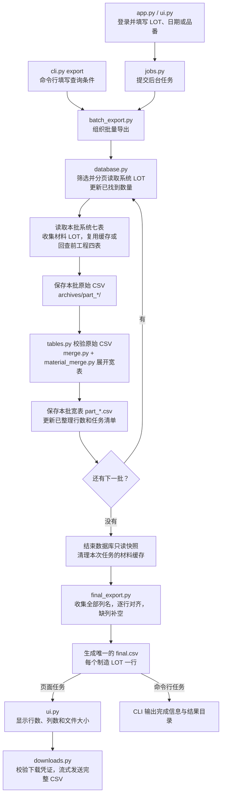
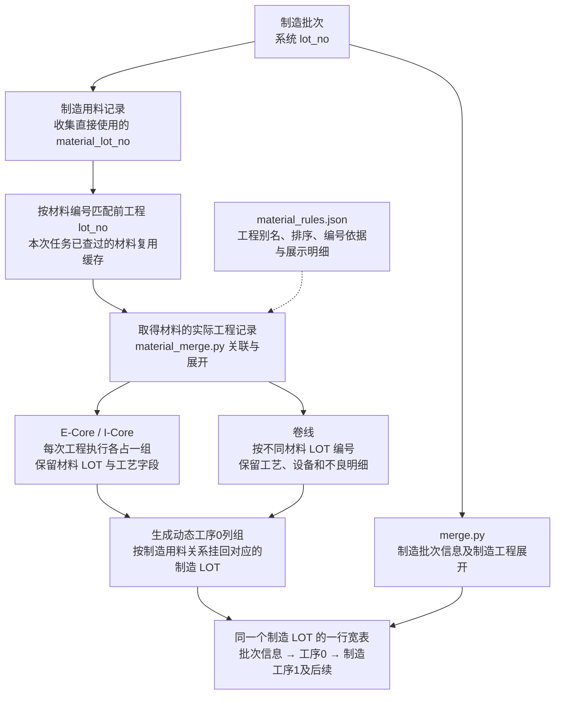

# 制造数据抽取项目

按系统 LOT、批次实际结束日期、品番查询。填写多个条件时取交集。前工程按直接用料的 `material_lot_no` 回库查询，使用材料自身的 LOT，日期和品番只筛系统 LOT。

## 项目文件

- `app.py` 启动页面，`ui.py` 负责操作界面。
- `cli.py` 统一提供批量导出、单 LOT 取数、离线合并、最终拼接和 CSV 筛选命令。
- `lot_extract/` 存放业务代码，`tests/` 保留离线回归用例。
- [当前开发文档](docs/制造数据条件抽取系统_开发文档_V0.4.md)和[可视化导入计划表](docs/reference/可视化导入计划表.xlsx)位于 `docs/`。

业务代码按下面的顺序阅读：

| 文件 | 负责什么 |
|---|---|
| `lot_extract/database.py` | 产品配置、查询条件、数据库读取和单次原始存档 |
| `lot_extract/tables.py` | 原始表结构、LOT 规则、CSV 校验和读写 |
| `lot_extract/merge.py` | 制造工程展开、材料挂接和离线合并 |
| `lot_extract/material_merge.py` | 材料规则加载及工序0展开 |
| `lot_extract/batch_export.py` | 分页取数、材料缓存、批量导出流程 |
| `lot_extract/final_export.py` | 按列对齐，生成最终 CSV |
| `lot_extract/jobs.py` | 后台任务、进度快照和取消 |
| `lot_extract/downloads.py` | 下载凭证与文件传输 |

页面主流程是 `ui.py → jobs.py → batch_export.py`。修改制造展开看 `merge.py`，修改材料展开看 `material_merge.py`，工程别名和展示选项改 `material_rules.json`。

## 项目流程图

### 整体导出流程

下面是页面查询和 `cli.py export` 共用的批量导出流程。每批处理完整的系统 LOT，原始数据和中间结果逐批落盘。



- 页面每两秒读取后台进度快照；查询阶段显示递增数量，最终 CSV 生成阶段显示写入进度条。
- 查询没有结果时记录零行任务，不生成 CSV；取消或失败时保留已完成的中间结果。上图展示正常有数据的路径。
- 单批超过资源上限时自动拆成更小的批次重试；单个 LOT 仍超限会报错，不截断记录。

### 材料 LOT 如何展开到同一行

关联方向是 **制造用料的 `material_lot_no` → 前工程的 `lot_no`**。材料增加的是工序0列组，最终行的主键始终是制造 `lot_no`。



材料查询只使用材料 LOT，不附加制造批次的日期或品番条件，也不递归查询材料的上游。E-Core、I-Core 不展开设备和不良；卷线同一材料的重复引用共用编号，额外执行保留在该材料组内。未识别工程或未匹配明细保留在异常列组，并产生核对提示。

## 启动

在项目目录安装依赖并运行：

```powershell
python -m pip install -r requirements.txt
python -m streamlit run app.py --server.address 127.0.0.1
```

页面使用 `.env` 的 `APP_PASSWORD` 登录。DFEC 沿用现有 `DB_HOST`、`DB_PORT`、`DB_NAME`、`DB_USER`、`DB_PASSWORD`、`DB_SCHEMA`、`DB_TIMEZONE`、`DB_SSLMODE`。默认 Schema 为 `public`，日期时区为 `Asia/Shanghai`。

接入结构和关联键相同的另一个产品时，在同一份本地 `.env` 增加产品代码和带前缀的连接设置：

```dotenv
LOT_PRODUCTS=DFEC,ABC
ABC_DB_HOST=
ABC_DB_PORT=5432
ABC_DB_NAME=
ABC_DB_USER=
ABC_DB_PASSWORD=
ABC_DB_SCHEMA=public
ABC_DB_TIMEZONE=Asia/Shanghai
```

重启后，页面会显示产品数据库选择。每次查询只使用选中的连接。所有产品须提供相同的七张表和关联字段。

## 原始文件和合并宽表

页面查询在后台按完整系统 LOT 分批处理，保存到 `outputs/queries/<产品>/batch_<任务编号>/`。可用 `EXPORT_DIR` 指定存档根目录。完成后自动按列名对齐，拼接为一份 `final.csv`。`part_*.csv` 只作为中间分片，`archives/part_*/` 保存对应的七张系统原始表和四张 `upstream_*.csv`。任务的 `manifest.json` 记录行数、列数、各阶段耗时、缓存命中及表头指纹。空表保留表头。

`lot_extract/merge.py` 负责制造工程展开和整体合并；`material_merge.py` 按制造用料 `material_lot_no` 找到前工程的 `lot_no`，把匹配到的材料工程接到同一行。每个制造 LOT 一行。

输出按「制造批次信息 → 工序0材料工程 → 工序1及后续制造工程」排列。

材料列按 `lot_extract/material_rules.json` 的工程顺序和别名规则生成。工程名归一化大小写、空格、连字符和下划线后与完整别名匹配。数据库出现新的正式名称时，在配置中补上别名并重启服务。E-Core 和 I-Core 每次执行各占一组，展示材料 LOT、工序键、道次和工艺字段。卷线按不同材料 LOT 编号，例如 `工序0_卷线1_material_lot_no` 和 `工序0_卷线2_material_lot_no`。同一制造 LOT 重复引用同一卷线材料时共用一个编号，额外的卷线执行在该材料组内保留。

卷线按材料 LOT、工序键和道次关联设备及不良，例如 `工序0_卷线1_机台设备1_machine_name` 和 `工序0_卷线1_不良1_defect_qty`。不良名称和数量各自占一列。工序0保留关联字段与有值的可选字段，`0` 是有效值。原始存档可用于核对材料批次属性和各工程的完整明细。

数据库查询和最终导出仅保留顶层系统 `lot_no` 以大写 `E` 开头、且整个编号仅含一个大写 `E` 的行。例如 `E6X08010` 保留，`EE6X08010`、`E6XE8010` 排除。材料 LOT 不套用此规则、系统日期或品番条件。旧存档可通过 `python cli.py filter` 应用同一规则。批处理没有符合条件的 LOT 时记录零行任务，不生成空分片。

页面每两秒刷新查询状态，显示已找到系统 LOT 数和已整理行数，数量随批次处理递增。查询阶段总数未知，使用动态状态提示，不额外执行全年 LOT 总数查询；取数结束后，按实际写入行数显示完整 CSV 的生成进度条。任务运行期间可取消。

查询完成后，页面展示数据行数（不含表头）、列数和实际 CSV 文件大小，并提供带 emoji 的完整 CSV 下载按钮。中间分片和任务清单只保存在服务器，不提供页面下载入口。完整文件通过同端口 HTTP 文件接口按块传输，支持 Range 请求，不进入 Streamlit 内存媒体缓存，不再设置 128 MiB 下载拦截；`EXPORT_DOWNLOAD_MIB` 已不再使用。实际传输速度受网络、磁盘和代理设置影响。

`app.py` 使用 Streamlit 1.58+ 的公开 `st.App` 接口同时挂载 `ui.py` 页面和下载路由，启动命令不变。下载凭证仅在登录后签发，链接一小时有效，页面刷新会续期；新查询或退出登录会撤销旧凭证，服务重启后也失效。请勿分享下载链接。每个服务进程仅运行一个页面导出任务，退出登录及关闭服务都会请求取消后台任务。

默认每批 500 个系统 LOT（`EXPORT_BATCH_LOTS`），单个 CSV 分片不超过 32 MiB（`EXPORT_PART_MIB`）。每批原始记录默认最多 100,000 行（`MAX_SOURCE_ROWS`）、原始 CSV 最多 640 MiB（`MAX_CSV_MIB`），宽表最多 400 万单元格（`MAX_WIDE_CELLS`）和 16,384 列。超限时自动二分 LOT 批次重试；单个 LOT 仍超限会明确失败，不截断记录。批处理不以 5,000 LOT 限制整个年度任务；`MAX_QUERY_LOTS` 只用于旧的单次取数入口。

最终拼接由 `lot_extract/final_export.py` 完成：收集所有分片列名，逐行按列名对齐，缺列补空，只输出一个表头，不合计数量、不重复转义原值。完整结果和中间分片均保持“批次信息 → 工序0 → 制造工程”的顺序。拼接按行写磁盘，不受单批总单元格预算限制；完整 CSV 超过 Excel 的行/列限制时显示提示，不截断数据。

## 手动工具

```powershell
python cli.py export --start 2026-01-01 --end 2026-12-31 --product DFEC --batch-size 500
python cli.py fetch LOT123 --product DFEC
python cli.py merge "outputs/queries/DFEC/查询编号" --output "outputs/宽表.csv"
python cli.py join "outputs/queries/DFEC/已完成的分批任务目录"
python cli.py filter "已有合并表.csv" --output "仅E批次.csv"
```

原来的三个命令行脚本已合并到 `cli.py`。`fetch` 只取数和存档，省略 LOT 参数时提示输入；`merge` 读取原始 CSV 并沿用页面的合并规则。所有入口共用 `lot_extract/` 内的业务代码。运行 `python cli.py --help` 或 `python cli.py <命令> --help` 查看参数；帮助和离线命令不加载数据库驱动。

`filter` 独立筛选已有最终 CSV；不传 `--output` 时生成同目录的 `*_E_only.csv`，禁止覆盖输入文件。

`join` 可以拼接此前已完成、只有分片的任务，不重新查询数据库。要求清单状态为完成，且目录尚无 `final.csv`，不会覆盖已有最终文件。

## 年度任务注意事项

同一任务取数使用一个只读、可重复读事务快照，材料原始记录缓存到系统临时目录的 SQLite；只复用本任务内已经完整读取的数据，查不到的材料也会记为已查询。取数完成后删除临时缓存并释放数据库快照，再进行本地拼接。每个分片合并完写磁盘并释放本批数据。

长时间快照可能推迟 PostgreSQL 旧版本回收。年度导出建议连接报表库或只读副本，并由数据库管理员核对 `lot_no`、日期及品番索引。程序仍保留单条语句超时；本地验证不代表生产库全年导出性能验收。

取消或失败不会删除已完成分片及其原始存档。完整 CSV 写完后发布。可以用 `cli.py merge` 重做已完成分片；当前版本不支持服务重启后恢复旧数据库快照，也不自动续查未完成部分。重新查询会创建新任务目录。
