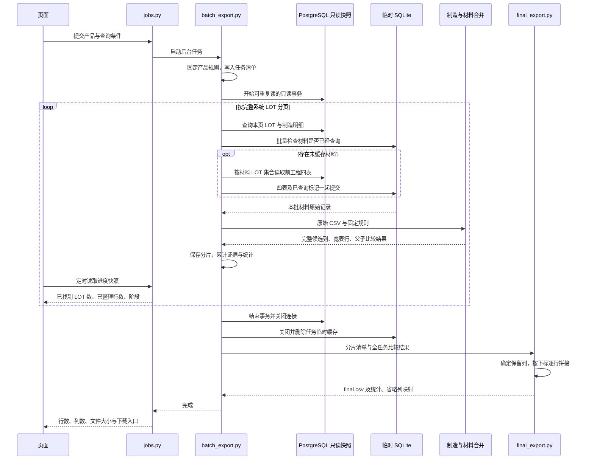
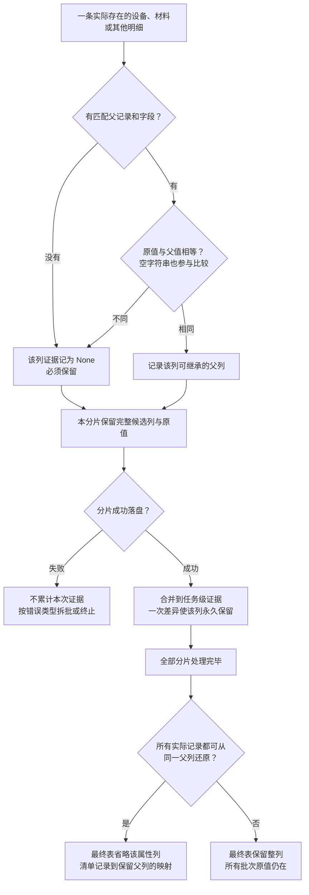

# 制造数据条件抽取系统开发文档

版本 V0.4，当前实现修订于 2026-11-13。保留原文件名以免已有链接失效。安装和日常命令见 [README](../README.md)，本文说明维护时需要掌握的规则与边界。

## 1. 目标与数据约定

根据系统 LOT、实际结束日期或品番，从 PostgreSQL 读取制造批次及其直接使用材料的前工程，生成一份 CSV 宽表。**一个制造 `lot_no` 对应一行**，材料工程只增加列组。多个查询条件取交集，至少填写一项。

制造原始表共七张，前工程复用同一个产品库中的四张表。`upstream_` 仅是存档文件前缀，无需建立同名实体表。

| 数据 | 表名 | 原始记录的候选键 |
|---|---|---|
| 批次 | `prass_lot` | `lot_no` |
| 工序 | `prass_lot_process` | `lot_no, process_key` |
| 不良 | `prass_process_defect` | `lot_no, process_key, pass_order, defect_code` |
| 用料 | `prass_process_material` | `lot_no, process_key, pass_order, seq` |
| 工具 | `prass_process_tool` | `lot_no, process_key, pass_order, tool_code` |
| 人员 | `prass_process_worker` | `lot_no, process_key, pass_order, worker_code` |
| 设备 | `prass_process_machine` | `lot_no, process_key, pass_order, machine_code` |

前工程读取批次、工序、不良、设备四表。用料关系为制造 `prass_process_material.material_lot_no` → 前工程各表的 `lot_no`。不递归读取材料自己的上游用料。

`tables.read_tables()` 校验必要字段、行宽和候选键。道次 `1` 与 `1.0` 按相同数值比较。候选键重复时直接报错，不取第一条、不自动累计。不同产品必须具有相同的表名、关联字段和业务含义；新增字段可以随原始表展开，改变表结构或事件键需要修改代码。

## 2. 模块架构与执行时序

生产代码维持 12 个 Python 文件（含包初始化文件），不再额外拆服务层或工具层。模块按维护时常一起修改的逻辑组织。

| 文件 | 职责与关键入口 |
|---|---|
| `app.py` / `ui.py` | Streamlit 页面、登录、条件输入、进度、取消和结果；`app.py` 同时挂载下载路由 |
| `cli.py` | `export`、`fetch`、`merge`、`join`、`filter`，数据库依赖只在在线命令加载 |
| `lot_extract/jobs.py` | 每进程单个后台导出任务、进度快照和取消信号 |
| `lot_extract/database.py` | `Filters`、`system_lot_where()`、只读事务、服务端游标和单次原始存档 |
| `lot_extract/batch_export.py` | `export_batches()` 调度分页、材料缓存、拆批、存档和最终拼接 |
| `lot_extract/tables.py` | 表结构、`LotPolicy`、CSV 校验、数值排序、数量格式、去重证据和受限写入 |
| `lot_extract/merge.py` | `merge_tables()` 展开制造工程并挂接材料；`merge_csv()` 提供离线入口 |
| `lot_extract/material_merge.py` | `ExportRules` 快照、产品材料配置、执行索引和动态工序0列组 |
| `lot_extract/final_export.py` | `column_rank()` 统一排序，`join_parts()` 统一省列并流式拼接 |
| `lot_extract/downloads.py` | 限时下载凭证与 HTTP 分块 / Range 传输 |

总体模块图见 [README](../README.md#模块架构)。以下时序图展示一项有数据的页面任务；`cli.py export` 直接调用同一个批量导出入口。



`ui.py` 不直接执行数据库查询，耗时操作由后台线程完成。取消信号在分页、读取和写入过程中检查；正在执行的数据库语句仍受其单条语句超时约束。

## 3. 多产品配置与规则快照

数据库账号和页面密码放在项目根目录本地 `.env`，不提交到 Git。`LOT_PRODUCTS=DFEC,ABC` 定义页面产品列表。DFEC 优先读取 `DFEC_DB_*`，缺省时兼容原 `DB_*`；其他产品只读取自己的 `<PRODUCT>_DB_*`，不会借用 DFEC 的连接信息。

| 配置 | DFEC 默认 | 新产品要求 |
|---|---|---|
| `<PRODUCT>_LOT_PREFIX` | `E` | 显式填写字面前缀；单独 `*` 表示所有非空 LOT |
| `<PRODUCT>_LOT_PREFIX_ONCE` | `1` | 默认 `0`；`1` 要求前缀只出现一次 |
| 材料规则文件 | `lot_extract/material_rules.json` | `lot_extract/material_rules_<产品代码小写>.json` |

前缀区分大小写，SQL 对 `%`、`_`、`!` 做字面转义，Python 使用同一 `LotPolicy` 校验。材料 LOT 仅按用料关系回查，不套用系统前缀规则。

材料配置是对象数组，数组顺序决定材料工程的列组顺序。一个对象的示例为：

```json
{
  "name": "卷线",
  "aliases": ["卷线", "卷线前工程", "winding"],
  "number_by": "material_lot",
  "details": ["machine", "defect"]
}
```

| 字段 | 含义与约束 |
|---|---|
| `name` | 列组中的工程名称；不能重复、含下划线/换行或以数字结尾 |
| `aliases` | 数据库 `process_name` 的完整别名；忽略大小写、空白、连字符和下划线后匹配，不同工程的别名不能重叠 |
| `number_by` | `execution` 按执行编号；`material_lot` 按不同材料 LOT 编号 |
| `details` | 可填 `machine`、`defect`，或空数组；控制设备和不良明细的展示 |

当前 DFEC 的 E-Core、I-Core、卷线都保留 `machine` 和 `defect`。默认工程不是固定槽位模板，没有“材料一定是 10 个”或“最终一定是 1,000 列”的截断规则。

规则文件按产品缓存，修改 `.env` 或 JSON 后重启服务。任务启动时生成 `ExportRules`，将版本、产品、LOT 规则、材料规则写入根清单及每个原始分片的 `manifest.json`。快照不包含数据库凭据。离线工具优先使用快照；显式 `--product` 与快照冲突会报错。没有快照的旧 DFEC 存档默认沿用原 E 前缀规则，其他产品需提供当前配置。

## 4. 查询、缓存与动态展开

### 查询边界

系统 LOT 和品番均精确匹配。日期使用“开始日 ≤ 实际结束时间 < 结束日的下一天”，包含结束当天的小数秒，并按配置的数据库会话时区解释。品番字段只允许 `murata_type` 或 `toko_type`。

日期、品番只用于系统批次。材料可能提前数月生产，材料回查不再套用这两个条件，也不逐月试探查询。

批处理使用 `lot_no > 上页末尾LOT`、`ORDER BY lot_no`、`LIMIT` 翻页，避免大 OFFSET。多取一条用于检查边界；进度只累计实际处理页，拆批重试不重复计数。每批用 `lot_no = ANY(%s)` 分别取明细，是按 LOT 集合查询，不是对每条 LOT 发一组 SQL。

一次任务共用只读、可重复读事务。服务端游标每次取 2,048 行到客户端，单条语句超时 30 秒。客户端分块不会消除数据库扫描，真实查询计划和索引效果仍需在公司环境确认。

### 材料缓存

`MaterialCache` 用临时 SQLite 保存材料四表、表头以及“已经完整查过”的 LOT。命中检查和明细读取均使用分组 `IN`，每组最多 500 个参数并服从连接自身的变量上限；查询条件中的 `source` 另预留一个参数位。写入使用 `executemany()` 消费生成器。

四表和已查询标记在同一个 SQLite 事务中提交。失败或取消时回滚，未查到数据的材料也标记为已查询，避免反复回库。保留日志与事务回滚能力，不设置 `journal_mode=OFF`。缓存只在本任务有效，取数完成后关闭并删除，不在内存保存全年材料 LOT 集合。

### 展开与编号

制造各类明细独立挂接父工序，不将多张一对多表直接 JOIN。工序按道次排序，同一道次的不同执行用 `_执行2` 等区分。材料设备与不良按 `(材料 lot_no, process_key, pass_order)` 关联，工序键相同但材料 LOT 或道次不同不能混挂。

| 工程 | 当前编号依据 | 示例 |
|---|---|---|
| E-Core / I-Core | 每次工程执行 | `工序0_E-Core1_material_lot_no` |
| 卷线 | 不同材料 LOT | `工序0_卷线1_material_lot_no`、`工序0_卷线2_material_lot_no` |
| 同一卷线材料的额外执行 | 原材料列组内追加执行号 | `工序0_卷线1_执行2_process_key` |

编号在每个制造 LOT 内重新开始。同一个制造 LOT 重复引用同一材料，前工程展示共用该材料编号，原始制造用料行仍逐条保留。工程未识别、缺工序或明细无法匹配时进入专门列组并提示；材料四表都没有记录时，制造用料列仍保留原材料编号。

不良以原始代码固定列身份，数量和名称分开。例如 `工序0_卷线1_不良_代码01` 保存数量，`_名称` 保存名称。同代码改名不会另开数量列，数量逐条保留。不同事件落入相同展示组时以 `_记录2` 等后缀区分；原始候选键重复依然报错。数量和名称都为空时保留 `_代码` 单元格，用于标识记录确实存在。

仅宽表的 `defect_qty`、`input_qty`、`output_qty` 去除普通小数尾零，例如 `85.000 → 85`、`85.500 → 85.5`，不舍入、不改写 LOT 和设备代码。原始 CSV 保存数据库读取格式。疑似电子表格公式的文本只在宽表首次写出时添加转义，最终拼接不重复转义。

## 5. 重复属性如何精简

核心原则是**保留设备和不良记录，只省略可从父字段还原的重复属性**。候选范围由 `BATCH_FIELDS` 和 `PROCESS_FIELDS` 定义，包含 LOT、`seiku`、品番、`lot_flag`、工序键、道次与起止时间；不按列名相似或空值比例猜测重复。

制造明细比较父工序字段，适用时回退到批次字段；材料明细只比较同一个材料执行的父工序。缺父记录、缺父字段或存在值差异都保留。设备代码缺失时保留 LOT 标识，避免精简后看不出实际有这条设备记录。



证据字典的三种状态为“没有键＝尚未比较”“父列名＝目前可还原”“`None`＝必须保留”。`tables.note_inheritance()` 保证出现差异后不能被后续相等记录覆盖。`inherited_columns()` 将“设备 → 工序 → 批次”链解析到最终保留列。

例如第一批的设备 `seiku` 全都等于父工序，第二批出现一个不同值，最终保留整列，两批设备的原值都写出。明细为空而父值非空也是差异。某 LOT 根本没有该设备时，缺少槽位不算差异；还原省略属性时必须先确认对应记录存在，不能给没有设备的 LOT 凭空填值。

批量导出调用 `merge_tables(..., inheritance=证据字典)`，先保存完整候选列，最后由 `join_parts()` 统一决定省列。单次离线 `merge` 只在传入的原始目录范围内判断；多个目录分别生成的精简表不能随意追加后当作整个任务的统一结果。旧任务没有证据时，`join` 不补猜省列信息。

## 6. 文件、拼接和资源边界

默认目录结构如下。`EXPORT_DIR` 可替换 `outputs/queries` 根路径。

```text
outputs/queries/DFEC/batch_<任务编号>/
├── manifest.json                 # 状态、规则快照、分片、证据、耗时和结果统计
├── archives/
│   └── part_000001/
│       ├── manifest.json         # 该批产品规则快照，可单独离线重做
│       ├── prass_*.csv            # 制造七表
│       └── upstream_prass_*.csv   # 材料四表
├── part_000001.csv               # 包含完整候选列的中间宽表
└── final.csv                     # 最终统一表头与精简后的完整结果
```

根清单的重要字段如下。

| 字段 | 用途 |
|---|---|
| `rules` | 可复现的产品规则快照 |
| `parts` | 分片路径、原始目录、行列数、字节数、表头指纹、提示和阶段耗时 |
| `inheritance` | 全任务父子字段比较结果；`null` 表示保留该列 |
| `final_csv.omitted_columns` | 已省略列 → 最终保留父列，用于解释精简结果 |
| `final_csv.rows / columns / bytes` | 不含表头的行数、最终列数和实际文件字节数 |
| `cache_hits / cache_misses` | 按各批材料请求累计的命中/未命中数，不能直接当作所有请求数或数据库 SQL 次数 |

`final_export.join_parts()` 分两遍处理。第一遍只读表头，收集并排序保留列；第二遍用 `csv.reader` 逐行读取。每片只计算一次“最终列 → 分片下标”，缺列指向追加的空字符串，表头完全一致时直接写当前行。校验 LOT、行宽、分片行数和两次读取间的表头指纹，全部写完才原子发布文件。这里不合计数量、不构造整年的 DataFrame，也未测得可承诺的提速倍数。

列顺序是“批次信息 → 工序0材料 → 制造工序 → 未匹配明细”。材料工程按配置数组顺序排列，保留旧版 `工序0-` 表头的排序兼容。最终省列发生在分片完成之后，因此中间文件仍可能较宽。

| 限制 | 默认值 | 作用范围 |
|---|---|---|
| `EXPORT_BATCH_LOTS` | 500 | 每页完整系统 LOT 数，允许 1～5,000 |
| `MAX_SOURCE_ROWS` | 100,000 | 每个分片的制造七表加材料四表记录数 |
| `MAX_CSV_MIB` | 640 MiB | 每个分片的原始 CSV 总字节预算 |
| `EXPORT_PART_MIB` | 32 MiB | 每个宽表分片，且不超过 `MAX_CSV_MIB` |
| `MAX_WIDE_CELLS` | 4,000,000 | 每个分片候选宽表的行数 × 列数，含空单元格 |
| 固定列数限制 | 16,384 | 每个分片候选宽表 |
| `MAX_QUERY_LOTS` | 5,000 | 单次 `fetch` 入口，不限制整个批处理任务总量 |

仅资源超限会自动二分 LOT 批次重试；单个 LOT 仍超限或数据键冲突会明确失败，不截断。最终拼接不套用单批单元格预算，跨片列并集或总行数超过 Excel 单工作表限制时给出提示并保留完整 CSV。

查询零结果时保留零行清单，不创建 `final.csv`。失败或取消保留已完成原始存档和分片；不能在服务重启后恢复旧数据库快照，也不跨任务断点续查。`cli.py join` 只处理有分片、状态完成且尚无 `final.csv` 的任务。

当前保留原始存档、中间分片和最终文件，没有任务 TTL 或自动清理功能，也没有自动创建数据库索引。长时间数据库快照可能推迟旧版本回收，应在公司环境评估报表库或只读副本、索引、磁盘及代理条件。

## 7. 页面与下载

页面每两秒读取后台快照，查询阶段显示递增的已找到 LOT 数、已整理行数和当前步骤。没有额外执行总数查询，查询结束后才有准确总量，最终拼接按写入行数显示进度。完成后显示行数、列数、文件大小和带 emoji 的完整 CSV 下载入口。

下载由同端口的文件接口按块传输，支持 GET / HEAD 和 Range，不进入 Streamlit 内存媒体缓存，不设置应用层单文件大小上限。实际能力仍取决于磁盘、网络和代理。`EXPORT_DOWNLOAD_MIB` 已不使用。

接口只访问登录页面注册的文件，不接收外部路径。下载凭证一小时有效，页面重绘可续期；新查询、退出登录或服务重启后旧凭证失效。链接持有者能使用凭证下载，应按结果文件同等保管。撤销阻止新请求，不能强行终止已经开始的传输。

## 8. 本版验证与维护入口

本版离线回归入口为：

```powershell
python -B -m unittest discover -s tests -p test_material_stage_zero.py -v
```

此命令只运行指定的 7 项离线用例，无需连接公司数据库。覆盖材料编号、多次执行、共用材料、道次精度、未匹配记录、完整别名匹配、制造道次0与材料工序0区分，以及分片对齐和旧表头排序；其中分片用例比较整批与分批结果的列及单元格，包含空值差异。其他诊断脚本不属于该离线入口。

2026-11-13 对本地下载的真实最终 CSV 进行只读核对，样本为 348 行、1,760 列。只统计工序0设备和不良中可与对应父工序核对的重复属性，结果如下。

| 材料工程 | 可精简的重复属性列 |
|---|---|
| E-Core | 183 |
| I-Core | 183 |
| 卷线 | 33 |
| 合计 | **399（约 22.7%）** |

单算这部分预计为 1,361 列，记录本身仍保留。上述统计以现有宽表为依据，并非新版完整查询后的列数；本地缺少该批原始十一表，仍需在公司环境重跑确认。新的不良代码列和其他字段保留规则也可能改变最终列数，不能把减少 399 列当成每次任务的固定收益。

此前完成的缓存模拟、历史样本和页面验证属于各自版本，不等同于本版生产端到端验收。本版尚未测量公司库月度或年度导出的耗时、峰值内存、磁盘需求和数据库负载。

维护时先从 [README 的修改入口表](../README.md#修改与验证) 找到模块。变更关联键或省列策略时，重点检查记录是否仍有身份标识、未匹配明细是否保留、空值差异是否保留、整批与分批输出是否一致。接入新产品时核对表结构、事件键、日期时区和读取权限，并与人工 SQL 的 LOT 集合及各表记录数比对。
